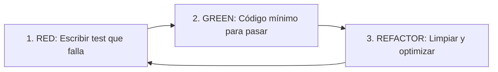

# Desarrollo Guiado por Pruebas (TDD - Test-Driven Development)

Esta skill proporciona los pasos, patrones y pautas operativas para aplicar la metodología TDD en cualquier tarea de desarrollo, refactorización o corrección de bugs, cubriendo tanto código de **Frontend** como de **Backend**.

---

## 1. Ciclo Fundamental de TDD (Red - Green - Refactor)

Todo desarrollo debe seguir estrictamente estas tres fases iterativas:



1. **🔴 FASE ROJA (RED):**
   - Antes de escribir cualquier línea de código de producción, escribir los tests que definan el comportamiento esperado.
   - Ejecutar la suite de tests y verificar que falle por la razón esperada (y no por un error de sintaxis o importación inválida).

2. **🟢 FASE VERDE (GREEN):**
   - Escribir únicamente el código mínimo necesario para que los tests pasen satisfactoriamente.
   - Ejecutar nuevamente los tests y confirmar que todos estén en verde.

3. **🔵 FASE DE REFACTORIZACIÓN (REFACTOR):**
   - Mejorar la estructura, legibilidad, modularidad y rendimiento del código sin alterar el comportamiento externo.
   - Asegurarse de que todos los tests sigan pasando después de cada cambio.

---

## 2. Convenciones de Nomenclatura, Helpers y Estructura Dado / Cuando / Entonces

### 🌐 Idioma y Títulos Cortos / Concisos
- **Todo en español:** Todos los nombres de suites (`describe`), pruebas (`it` / `test`), funciones auxiliares (helpers), variables y comentarios deben estar redactados en **español**.
- **Títulos cortos, directos y concisos:** Los nombres deben servir de documentación viva clara y rápida de leer. Deben expresar qué se prueba sin detalles superfluos ni redacción extensa:
  ```typescript
  // Estructura base
  it('Dado [contexto] Cuando [acción] Entonces [resultado]', () => { ... });

  // ✅ BUENO (Corto, conciso y documenta el comportamiento):
  it('Dado formulario vacío Cuando envía Entonces señala título obligatorio', ...);
  it('Dado credenciales inválidas Cuando ingresa Entonces rechaza con ErrorCredenciales', ...);

  // ❌ EVITAR (Excesivamente largo o verboso):
  it('Dado un formulario de entrenamiento completamente nuevo y sin datos Cuando el usuario hace click en el botón de guardar sin completar el título Entonces muestra el mensaje de error en pantalla indicando que es obligatorio', ...);
  ```

### ⚡ Regla Estricta: Un Solo "Cuando" (Single Act)
- **Siempre un único `act` por prueba:** Cada test debe tener **exactamente una sola acción disparadora / estímulo**.
- **Prohibido encadenar múltiples "Cuando":** No combinar múltiples acciones consecutivas en un mismo test para probar flujos largos. Si se necesitan probar pasos subsecuentes, se debe crear un test separado configurando el estado inicial correspondiente en el "Dado".

### 🛠️ Uso de Helpers (`dado...`, `cuando...`)
Para maximizar la legibilidad y reutilización, encapsular la preparación y los actos en funciones auxiliares (helpers) descriptivas:

```typescript
// Ejemplo en Frontend / Componentes
describe('FormularioEntrenamiento', () => {
  it('Dado formulario vacío Cuando envía Entonces señala título obligatorio', async () => {
    // DADO (Arrange) - Helper de preparación y renderizado
    const { formulario } = dadoFormularioRenderizado();

    // CUANDO (Act) - UN SOLO "CUANDO" (única acción)
    await cuandoEnvia(formulario);

    // ENTONCES (Assert) - Verificación
    expect(pantalla.obtenerPorTexto(/título obligatorio/i)).toBeInTheDocument();
  });
});

// Ejemplo en Dominio / Servicios / Backend
describe('ServicioAutenticacion', () => {
  it('Dado usuario no registrado Cuando ingresa Entonces lanza ErrorCredenciales', async () => {
    // DADO (Arrange) - Helper de preparación
    const servicio = dadoServicioConBaseVacia();

    // CUANDO + ENTONCES (Act único y verificación)
    await expect(cuandoIngresa(servicio, 'correo@test.com', 'clave123'))
      .rejects.toThrow(ErrorCredenciales);
  });
});
```

---

## 3. Reglas de Ejecución y Comandos

- **Prohibido código sin test previo:** No implementar lógica de negocio, endpoints, componentes o utilidades sin haber escrito primero la prueba correspondiente.
- **Validación continua:** Ejecutar los tests en cada paso del ciclo para validar objetivamente los estados *Red* y *Green*.
- **Comando de tests del proyecto:** Usar siempre `npm test` (o `npx vitest run`, una sola pasada).
  > ⚠️ **IMPORTANTE:** Nunca ejecutar comandos en modo observador (`npm run test:watch` o `npx vitest` sin `run`), ya que bloquean el proceso interactivo.
- **No alterar tests arbitrariamente:** Nunca modificar una prueba existente para forzar que pase; adaptar la implementación, a menos que el requerimiento de negocio haya cambiado explícitamente.
- **Cobertura de casos límite:** Además del camino feliz (*happy path*), diseñar pruebas para casos borde, validaciones fallidas, errores de red/servidor y estados vacíos.

---

## 4. Pautas Específicas por Capa

### 🎨 Frontend (UI, Hooks, Store, Componentes)
- **Filosofía Testing Library:** Probar el comportamiento desde la perspectiva del usuario final (consultar por roles, textos, labels accesibles; no por selectores CSS o detalles internos de implementación).
- **Helpers de interacción:** Crear helpers como `dadoComponenteRenderizado(...)`, `cuandoUsuarioHaceClick(...)`, `cuandoUsuarioEscribe(...)`.
- **Alcance de pruebas:**
  - Renderizado inicial y estados condicionales (cargando, error, vacío, éxito).
  - Interacciones del usuario (clicks, tipeo, envíos de formulario).
  - Custom hooks y lógica de estado (actions, reducers, stores).
  - Mocking de llamadas a APIs / servicios externos mediante dobles en memoria para mantener tests rápidos y deterministas.

### ⚙️ Backend y Lógica de Negocio (APIs, Servicios, Dominio, Repositorios)
- **Helpers de datos:** Crear funciones fábrica (`dadoUsuario(...)`, `dadoEntrenamientoValido(...)`) y dobles en memoria.
- **Alcance de pruebas:**
  - **Capa de Dominio/Servicio:** Pruebas unitarias puras de la lógica de negocio, reglas de cálculo y validaciones.
  - **Capa de Controladores/Rutas:** Pruebas de integración para endpoints HTTP (validando códigos de estado HTTP, estructura de respuestas JSON, headers y manejo de errores 4xx/5xx).
  - **Capa de Datos/Repositorios:** Validar persistencia, consultas y transacciones con bases de datos en memoria o fixtures aislados.
